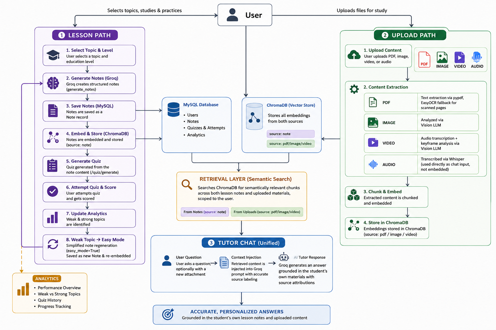
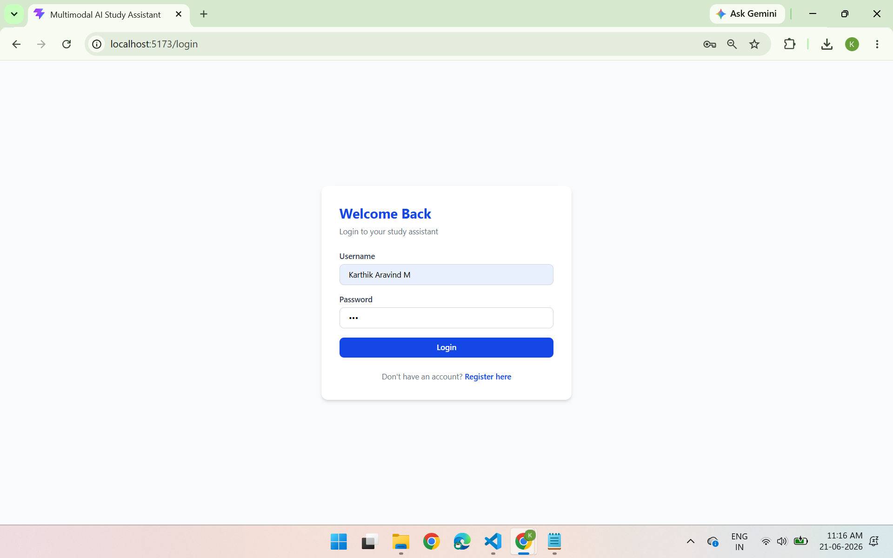
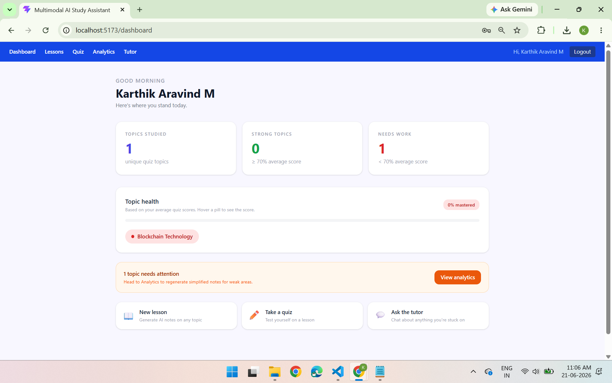
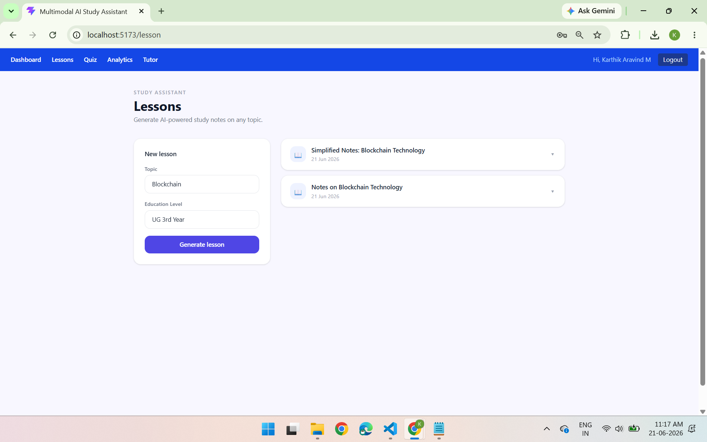
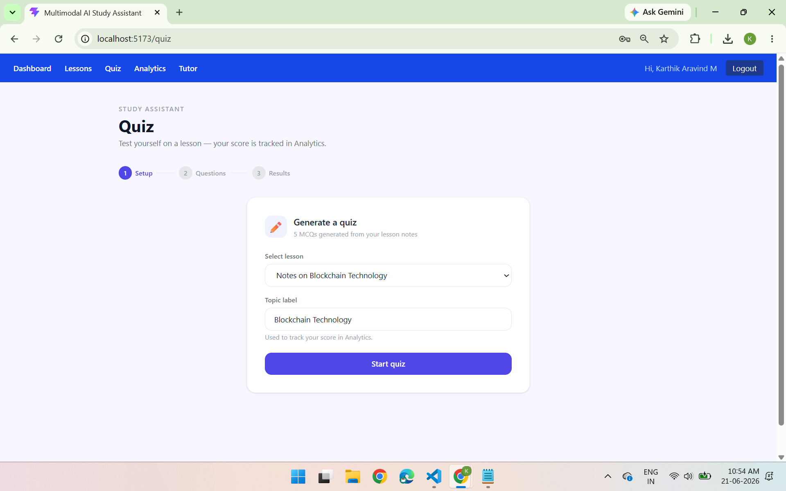
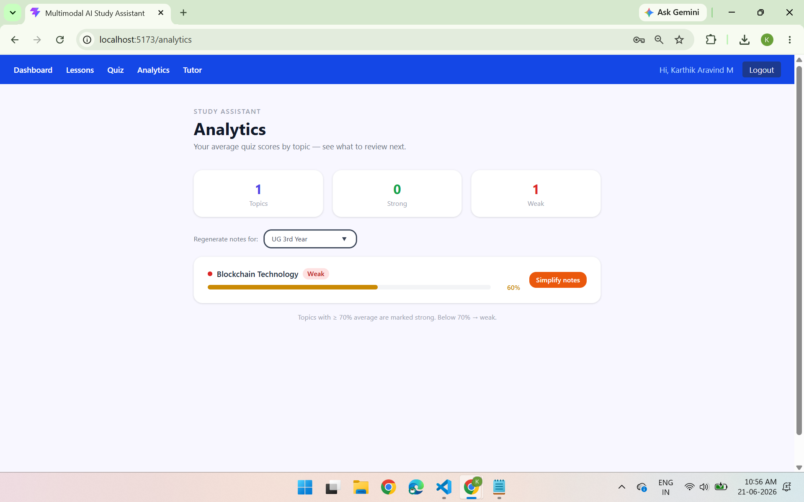
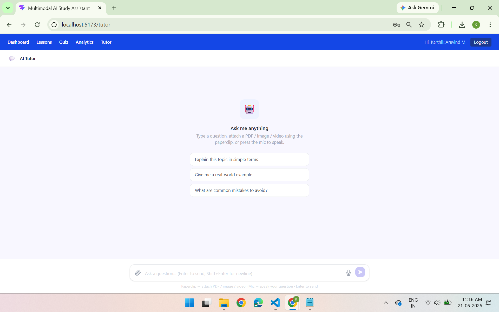
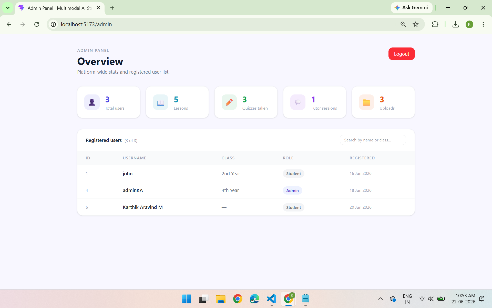

# 📚 Multimodal AI Study Assistant

An AI-powered learning platform that helps students learn better by generating quizzes, analyzing performance, identifying weak topics, and creating personalized simplified notes.

---

##  Features

-  User Authentication (JWT)
-  Upload PDFs, Images, Videos, and Audio
-  Text Extraction (PDF parsing via `pypdf`, with OCR fallback for scanned pages)
-  Video Analysis (audio transcription + keyframe extraction via Vision LLM)
-  Voice Input (Whisper-based speech-to-text)
-  AI-generated Quizzes
-  Quiz Analytics Dashboard
-  Weak Topic Detection
-  Simplified Notes Generation
-  Semantic Search using Vector Embeddings (RAG)
-  AI Tutor Chat with RAG-based context retrieval
-  Admin Dashboard
-  Lesson Management

### ✨ Standout features

- **Live streaming answers** — tutor replies and lesson notes type out word by word (Server-Sent Events),
  with a Stop button. Nothing is saved until the answer is complete, so a stopped or failed stream leaves no half messages.
- **Clickable source citations** — the AI Tutor cites where every fact came from, inline as `[S1]`, `[S2]`.
  Clicking a citation opens the PDF **at the exact page**, plays the video **from the exact timestamp**
  (Whisper segment timings), shows the image, or jumps to the lesson.
- **Self-healing learning loop** — score below 70% and the app generates fix-up notes that target exactly
  the questions you missed (including *why* your answer was wrong), then a fresh retest on the same concepts.
  Repeat until you pass (max 5 rounds). Analytics shows each topic's score history and status:
  *Needs work → In recovery → Recovered ✓*. Mastery uses your **last 3 attempts**, so recovery counts.
- **Smarter quizzes** — multiple choice, true/false, fill-in-the-blank and numerical questions at Easy / Medium /
  Hard / Mixed difficulty. Every answer is explained, and for a wrong multiple-choice pick you see *why that option*
  is wrong. Typed answers are marked fairly: small typos and synonyms are accepted for fill-ins, numbers within a
  tolerance (units, commas, `1.5e-3`, `1/4` all understood).
- **Spaced-repetition flashcards (SM-2)** — cards made by AI from any lesson, plus every wrong quiz answer and
  weak viva answer turned into a card automatically. A daily review queue (Again / Hard / Good / Easy, with keyboard
  shortcuts) schedules each card right before you'd forget it. One-click export to Anki.
- **Tamil / Hindi / English-mixed replies** — pick English, Hindi, Tamil, Hinglish, Tanglish or **Auto** from the
  🌐 menu in the navbar (saved to your profile). It applies to the tutor, lessons, fix-up notes, quiz explanations and
  the viva. *Auto* answers in the language you asked in: script detection plus common romanised Hindi/Tamil words,
  so "photosynthesis enna?" gets a Tanglish answer. Quiz questions stay in English so answers can be marked reliably,
  and the viva reads Hindi/Tamil questions aloud with a matching voice when the browser has one.
- **Handwritten solution checking** — photograph your worked maths/science solution and the vision model
  (Llama 4 Scout) transcribes every line, re-does each step and marks it ✓ / ✗ / "carries the earlier mistake",
  pointing to the **first mistake** with what went wrong and a hint (the corrected step stays hidden until you ask).
  If a line was misread you can fix the transcription and re-check. An optional answer key is compared
  deterministically. A mistake can be saved as a "spot the mistake" flashcard or sent to the tutor.
- **Viva / oral-exam mode** — an AI examiner asks open-ended questions out loud (browser text-to-speech),
  you answer by voice (Whisper) or text, and each answer is graded 0–10 with feedback, a model answer
  and the key points you missed. Past vivas can be resumed or reviewed.

---

## 🛠 Tech Stack

### Frontend
- React.js
- Tailwind CSS
- Axios
- React Router
- Vite

### Backend
- FastAPI
- SQLAlchemy
- JWT Authentication (`python-jose`, `passlib`, `bcrypt`)

### AI Components
- Groq API (LLaMA for text generation, Whisper for audio transcription, Vision models for image/video frame analysis)
- Sentence Transformers
- ChromaDB
- EasyOCR
- pdf2image
- OpenCV
- moviepy

### Database
- MySQL (via PyMySQL)

---

## 📂 Project Structure

```text
MULTIMODAL AI ASSISTANT/
│
├── Frontend/
│   ├── src/
│   │   ├── api/            axios instance + error helper
│   │   ├── components/     Navbar, route guards, Spinner, Markdown renderer
│   │   ├── context/        auth state (AuthContext.jsx, useAuth.js)
│   │   ├── hooks/          usePageTitle
│   │   ├── pages/          one file per page
│   │   ├── App.jsx
│   │   ├── main.jsx
│   │   └── index.css
│   ├── .env.example        VITE_API_URL
│   ├── package.json
│   ├── vite.config.js
│   └── index.html
│
├── Routers/                FastAPI route modules
├── Services/               LLM, vision, audio, video, embedding logic
├── migrations/             Alembic database migrations
│
├── auth.py
├── database.py
├── models.py
├── schemas.py
├── main.py
├── create_admin.py         create / promote an admin account
├── alembic.ini
├── requirements.txt
├── .env.example
│
└── Chroma_DB/              local vector store (git-ignored)
```

---

## ⚙️ Installation

### Prerequisites

- Python 3.10+
- Node.js 18+
- MySQL server running locally
- [Poppler](https://github.com/oschwartz10612/poppler-windows/releases/) installed and added to PATH (required by `pdf2image` for scanned-PDF OCR fallback)
- On first run, EasyOCR will download its model weights — this can take a minute and may look like the app is hanging

### Clone Repository

```bash
git clone https://github.com/username/project-name.git

cd project-name
```

---

### Backend Setup

```bash
pip install -r requirements.txt

python -m alembic upgrade head

uvicorn main:app --reload
```

The schema is managed with **Alembic** (`migrations/`). Create the empty MySQL database first and point `DATABASE_URL` at it; `python -m alembic upgrade head` then creates or updates all tables. After changing `models.py`, generate a migration with `python -m alembic revision --autogenerate -m "describe change"`.

Backend runs at

```text
http://localhost:8000
```

#### Create an admin account

New sign-ups are always students. To create an admin (or promote an existing user):

```bash
python create_admin.py <username>
```

You'll be asked for the password at a hidden prompt. Use `--demote` to turn an admin back into a student.

---

### Frontend Setup

```bash
cd Frontend

npm install

npm run dev
```

Frontend runs at

```text
http://localhost:5173
```

> **Note:** the backend allows requests from `http://localhost:5173` by default. To use another frontend URL, set `ALLOWED_ORIGINS` in `.env` (comma-separated). To point the frontend at another backend, set `VITE_API_URL` in `Frontend/.env.local` (see `Frontend/.env.example`).

---

## 🔑 Environment Variables

Copy `.env.example` to `.env` in the project root and fill it in:

```env
GROQ_API_KEY=

SECRET_KEY=

DATABASE_URL=

# optional, comma-separated
ALLOWED_ORIGINS=http://localhost:5173
```

## System Architecture



---

## 🚀 Workflow

The platform has two independent content pipelines that converge at a single retrieval layer for the AI Tutor.

### 1️⃣ Lesson Path

1. User selects a topic and education level
2. Groq generates structured notes (`generate_notes`)
3. Notes are saved as a `Note` record in MySQL
4. Notes are embedded and stored in ChromaDB (`source: note`)
5. Quizzes are generated from the note content (`/quiz/generate`)
6. Quiz is attempted and scored
7. Analytics are updated, identifying weak and strong topics
8. Weak topics can trigger simplified note regeneration (`easy_mode=True`), saved as a new `Note` and re-embedded

### 2️⃣ Upload Path

1. User uploads a PDF, image, video, or audio file
2. Content is extracted:
   - PDF → text extraction via `pypdf`, with EasyOCR as a fallback for scanned pages
   - Image → analyzed via Vision LLM
   - Video → audio transcription + keyframe analysis via Vision LLM
   - Audio → transcribed via Whisper (used directly as chat input, not embedded)
3. Extracted content is chunked and embedded into ChromaDB (`source: pdf / image / video`)

### 3️⃣ Tutor Chat (unifies both pipelines)

1. User asks a question, optionally with a new attachment
2. Semantic search retrieves relevant chunks from ChromaDB across both lesson notes and uploaded materials, scoped to the user
3. Retrieved context is injected into the Groq prompt with accurate source labeling
4. AI Tutor responds with an answer grounded in the student's own materials

---

## 📸 Screenshots

### Login Page



### Dashboard Page



### Lesson Page



### Quiz Page



### Analytics Dashboard



### Tutor Page



### Admin Page (accessible only for the admin)



---

## 📡 API Endpoints

| Method | Endpoint | Description |
|--------|----------|-------------|
| POST | `/register` | Register user |
| POST | `/login` | Login |
| GET | `/me` | Current user's profile |
| PATCH | `/me` | Update profile settings (reply language) |
| POST | `/upload/pdf` | Upload and index a PDF |
| POST | `/upload/image` | Analyze and index an image |
| POST | `/upload/audio` | Transcribe audio (Whisper) |
| POST | `/upload/video` | Analyze video (transcript + frames) |
| GET | `/upload/materials` | List your uploaded materials |
| DELETE | `/upload/materials/{id}` | Delete an upload and its indexed content |
| POST | `/lessons/generate` | Generate an AI lesson on a topic |
| POST | `/lessons/generate/stream` | Same, streamed live as Server-Sent Events |
| GET | `/lessons/all` | Get all lessons for the user |
| POST | `/lessons/regenerate-weak` | Simplify notes for a weak topic |
| POST | `/quiz/generate` | Generate a quiz from a lesson (question types, difficulty, length) |
| POST | `/quiz/submit` | Submit answers and get scored results |
| GET | `/analytics` | User's quiz analytics (weak/strong topics) |
| POST | `/chat` | AI Tutor chat (RAG-based, returns clickable citations) |
| POST | `/chat/stream` | Same, streamed live as Server-Sent Events |
| GET | `/upload/materials/{id}/file` | Original uploaded file (for opening citations) |
| POST | `/learning/remediate` | Fix-up notes + retest for a failed quiz |
| GET | `/learning/progress` | Per-topic score history and recovery status |
| POST | `/viva/start` | Start an oral exam on a lesson |
| POST | `/viva/{id}/answer` | Grade the answer to the current viva question |
| GET | `/viva/history` | Past vivas |
| GET | `/viva/{id}` | Resume or review a viva |
| GET | `/flashcards/due` | Today's review queue (SM-2) |
| POST | `/flashcards/{id}/review` | Rate a card: again / hard / good / easy |
| POST | `/flashcards/generate` | AI flashcards from a lesson |
| GET / POST | `/flashcards` | List / add cards (PATCH, DELETE `/flashcards/{id}`) |
| GET | `/flashcards/export/anki` | Download all cards for Anki import |
| POST | `/solutions/check` | Photo of handwritten working → step-by-step marking, first mistake |
| POST | `/solutions/{id}/recheck` | Re-mark with a corrected transcription |
| POST | `/solutions/{id}/flashcard` | Save the first mistake as a flashcard |
| GET | `/solutions/history` | Past solution checks (`GET` / `DELETE /solutions/{id}`, `GET /solutions/{id}/image`) |
| GET | `/admin/users` | List all users *(admin only)* |
| GET | `/admin/stats` | Platform usage stats *(admin only)* |

---

## 🎯 Future Improvements

- Mobile application
- Dockerization

---

## 👨‍💻 Developed by

**Karthik Aravind M**

---
